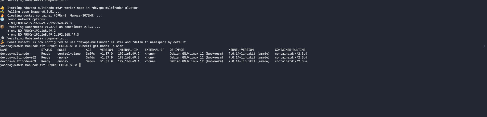
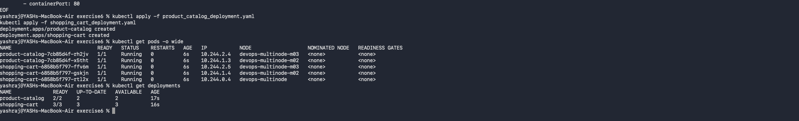
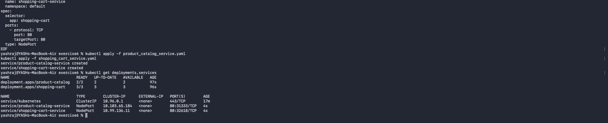
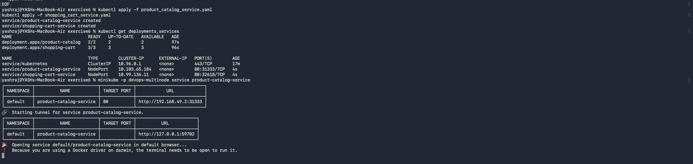

# Exercise 10: Multi-Node Kubernetes Cluster with Multiple Applications and Replicasets


### 1. Cluster and pod distribution

The captured output shows three nodes in `Ready` state: `devops-multinode` (control-plane) and two workers, `devops-multinode-m02` and `devops-multinode-m03`. All five application pods are `Running`, with `1/1` containers ready and zero restarts.

The Product Catalog Deployment runs 2 replicas and the Shopping Cart Deployment runs 3 replicas.

| Node | Product Catalog pods | Shopping Cart pods |
|---|---:|---:|
| `devops-multinode` | 0 | 1 |
| `devops-multinode-m02` | 1 | 1 |
| `devops-multinode-m03` | 1 | 1 |





### 2. Building and loading the images

Both Flask applications were built locally from `python:3.9-slim`, producing the `product-catalog:latest` and `shopping-cart:latest` images:


The images were then loaded into the Minikube cluster so that every node can use them:

```bash
minikube -p devops-multinode image load product-catalog:latest
minikube -p devops-multinode image load shopping-cart:latest
minikube -p devops-multinode image ls | grep -E 'product-catalog|shopping-cart'
```

Both images (`docker.io/library/product-catalog:latest` and `docker.io/library/shopping-cart:latest`) appear in the cluster image list.


### 3. Deployments and Services

The Deployments were created with `kubectl apply`, followed by NodePort Services for each application:

```bash
kubectl apply -f product_catalog_deployment.yaml
kubectl apply -f shopping_cart_deployment.yaml
kubectl apply -f product_catalog_service.yaml
kubectl apply -f shopping_cart_service.yaml
kubectl get deployments,services
```

Both Deployments report all replicas ready (`2/2` and `3/3`), and the Services were created successfully:

- `product-catalog-service`: NodePort `31333`, target port `80`
- `shopping-cart-service`: NodePort `32618`, target port `80`



### 4. Minikube tunnel

Because the Docker driver on macOS is used, `minikube service` opens a local tunnel to reach the NodePort Service:

```bash
minikube -p devops-multinode service product-catalog-service
```

The Minikube tunnel provided this local URL:

- Product Catalog: `http://127.0.0.1:59702`

Keep the terminal running `minikube service` open while using the tunnel URL.


