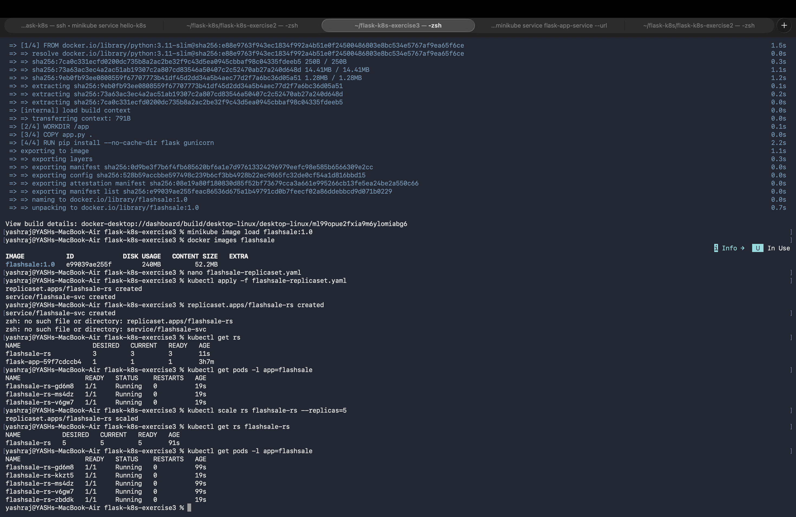

# Exercise 3 — Scaling Flask App on Single Node using ReplicaSets

## Final Result

The Flask Flash Sale application was successfully deployed on a single-node Minikube cluster using a Kubernetes ReplicaSet.

The application was initially deployed with **3 replicas** and was successfully scaled to **5 replicas**. All 5 Pods were running and ready after scaling.

---

## Scaling Verification

- **Initial replicas:** 3
- **Scaled replicas:** 5
- **Running Pods:** 5
- **Ready Pods:** 5
- **Cluster:** Minikube (Single Node)

---

## Technologies Used

- Python
- Flask
- Docker
- Kubernetes ReplicaSet
- Minikube
- PowerShell

---

## Conclusion

Successfully deployed a Flask application using a Kubernetes ReplicaSet and demonstrated horizontal scaling by increasing the number of replicas from 3 to 5. Verified that all 5 Pods were running and ready after scaling.
