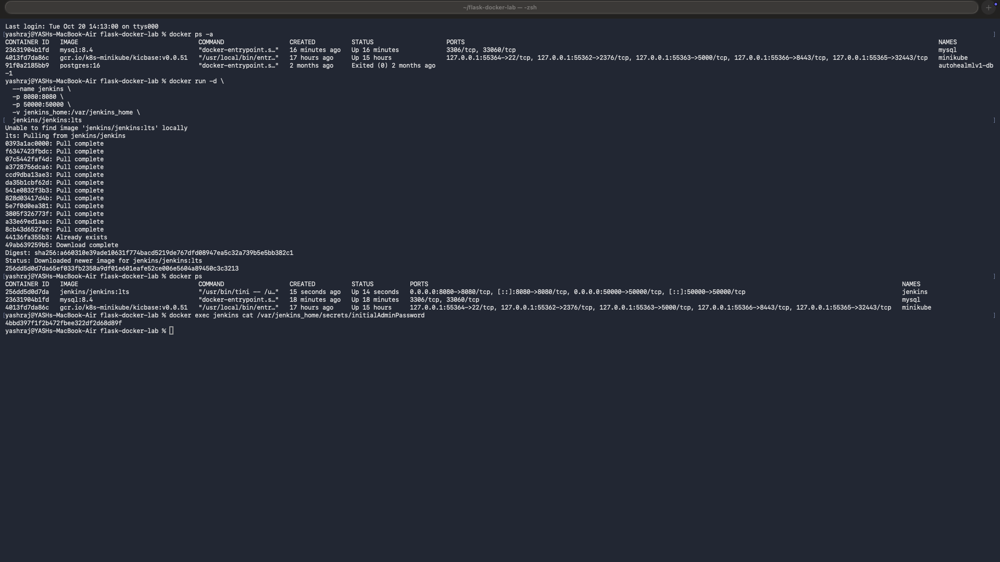
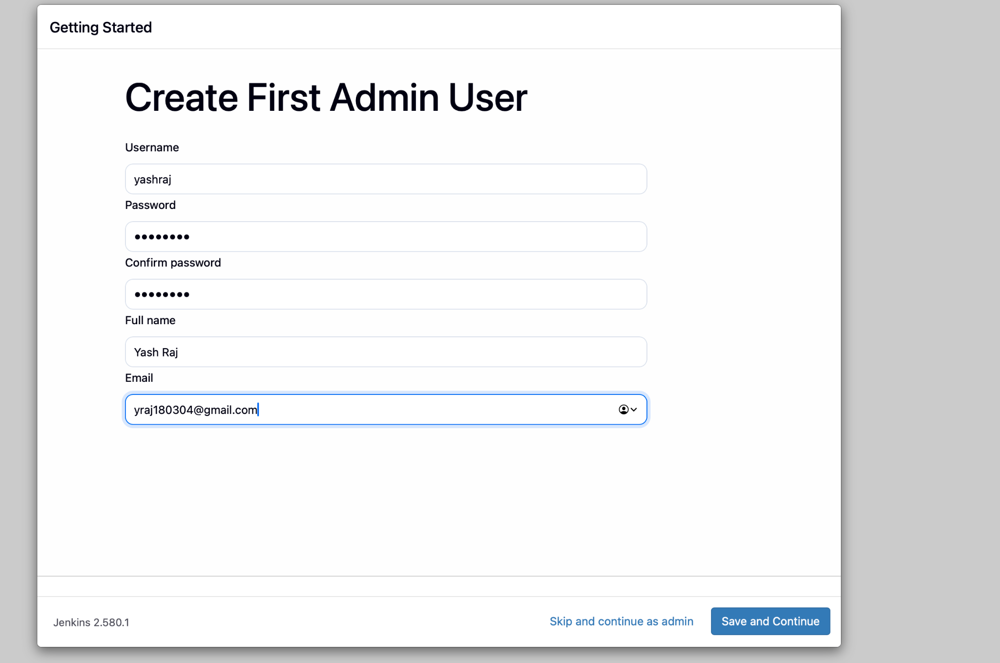
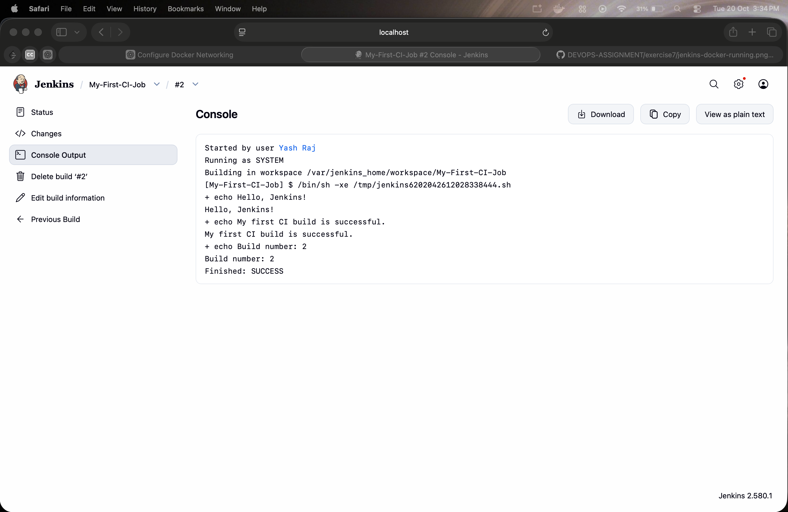

# Exercise 7 — Introduction to Continuous Integration (CI) and Jenkins Installation

## 1. Jenkins Docker Container Deployment

The Jenkins LTS image was downloaded, and the Jenkins container was started successfully. Since host port `8080` was unavailable, Jenkins was exposed on port `8081`, mapped to container port `8080`. The container was verified as running with Docker.

---

## 2. Create the First Administrator User

The Jenkins setup wizard was accessed at `http://localhost:8081/`. The first administrator account details were entered to configure access to Jenkins.

---

## 3. Jenkins Setup Completed

Jenkins displayed the **"Jenkins is ready!"** confirmation, indicating that the initial setup was complete. The next step is to select **Start using Jenkins** to open the Jenkins dashboard.

---

## Technologies Used

- Jenkins LTS
- Docker
- Continuous Integration (CI)

---

## Conclusion

Successfully installed Jenkins using Docker, configured the first administrator account, and completed the initial Jenkins setup.
